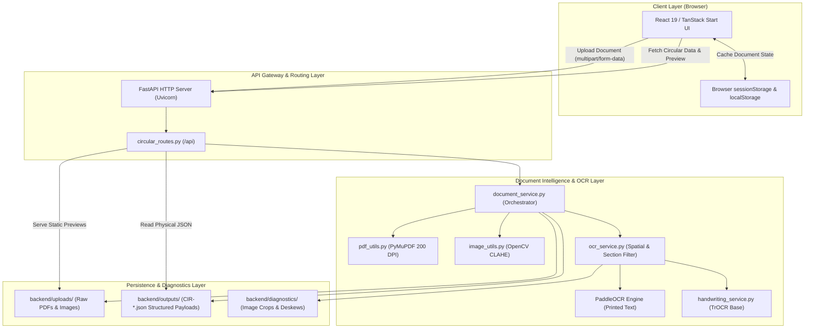
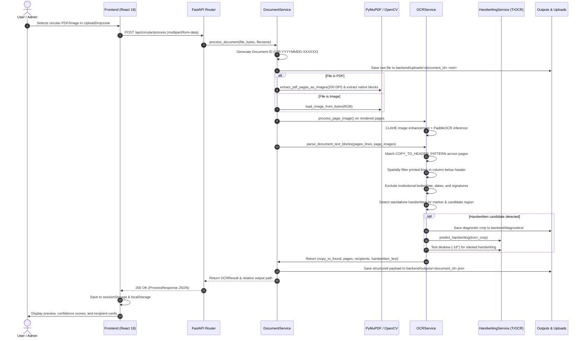

# CircularRoute — System Architecture & Data Flow

This document details the architectural design, system components, end-to-end OCR processing pipeline, and data flow of **CircularRoute — Intelligent Circular Distribution System**.

---

## 1. High-Level Architecture Overview

CircularRoute is an institutional document intelligence system engineered to ingest administrative circulars (PDFs and scanned images), locate the "Copy To" / distribution list section, extract printed and handwritten recipients exactly as written, and present the structured results to administrators for review and routing.

The system is structured across four primary architectural layers:



---

## 2. End-to-End OCR Processing Pipeline

The core OCR processing pipeline follows a rigorous 11-stage pipeline. The system enforces the design philosophy **"READ -> PRESERVE -> STRUCTURE"**: names, designations, and abbreviations are preserved without semantic distortion or guessing.



### Detailed Pipeline Stages

#### Stage 1: File Validation & Registration
- **Module:** [circular_routes.py](file:///c:/Users/Asus/Documents/CircularRoute/backend/app/api/circular_routes.py) & [document_service.py](file:///c:/Users/Asus/Documents/CircularRoute/backend/app/services/document_service.py)
- **Actions:** Verifies uploaded file extension against `.pdf`, `.jpg`, `.jpeg`, `.png`, `.webp`. Rejects unsupported types with `HTTP 400 Bad Request` and error code `UNSUPPORTED_FILE_TYPE`.
- **Identity Assignment:** Generates unique institutional Document ID: `CIR-<YYYYMMDD>-<6_HEX_CHARS>` (e.g., `CIR-20261019-1A1084`).
- **Raw Storage:** Persists raw binary to `backend/uploads/<document_id><ext>` for browser preview serving.

#### Stage 2: Page Extraction & Image Rasterization
- **Module:** [pdf_utils.py](file:///c:/Users/Asus/Documents/CircularRoute/backend/app/utils/pdf_utils.py) & [image_utils.py](file:///c:/Users/Asus/Documents/CircularRoute/backend/app/utils/image_utils.py)
- **PDF Documents:** PyMuPDF (`fitz`) rasterizes vector PDF pages at **200 DPI** (`zoom = 200 / 72.0`) into RGB PIL Images. Also attempts native vector text block extraction (`doc[i].get_text("blocks")`).
- **Scanned Images:** Loaded via PIL `Image.open` and converted to standard RGB space.

#### Stage 3: Image Preprocessing & Printed Text OCR
- **Module:** [image_utils.py](file:///c:/Users/Asus/Documents/CircularRoute/backend/app/utils/image_utils.py) & [ocr_service.py](file:///c:/Users/Asus/Documents/CircularRoute/backend/app/services/ocr_service.py)
- **Enhancement:** Applies OpenCV CLAHE (Contrast Limited Adaptive Histogram Equalization) with `clipLimit=2.0` and `tileGridSize=(8, 8)` in LAB color space to sharpen character edges without eliminating faint handwritten strokes.
- **Inference:** PaddleOCR runs on the preprocessed page. The service dynamically adapts to either:
  - PaddleOCR 3.x / PaddleX dictionary output (`rec_texts`, `rec_scores`, `rec_boxes` / `rec_polys`).
  - PaddleOCR 2.x tuple list output (`[[[x0, y0], ...], (text, score)]`).
- **Fallback:** If PaddleOCR produces no lines, PyTesseract serves as an automated fallback if installed.

#### Stage 4: "Copy To" Section Header Detection
- **Module:** [ocr_service.py](file:///c:/Users/Asus/Documents/CircularRoute/backend/app/services/ocr_service.py)
- **Regex Detection:** Scans text lines across all pages using `COPY_TO_HEADER_PATTERN`:
  ```python
  re.compile(r'^\s*(?:copy\s+to|copies\s+to|distribution|circulation|for\s+information\s*(?:to)?|cc|c\.c\.)\s*[:-]?', re.I)
  ```
- **Inline Parsing:** Detects inline recipients on the same line as the header (e.g., `Copy to: 1. The Principal`).
- **Page Tracking:** Records all pages containing a distribution section in `copy_to_pages`.

#### Stage 5: Spatial Column Filtering & Continuity Tracking
- **Module:** [ocr_service.py](file:///c:/Users/Asus/Documents/CircularRoute/backend/app/services/ocr_service.py)
- **Bounding Box Geometry:** Measures bounding box coordinates `[x0, y0, x1, y1]` relative to header box `[hx0, hy0, hx1, hy1]`.
- **Column Alignment:** Restricts candidate lines to `hx0 - 50 <= x0 <= hx0 + 180` to prevent capturing unrelated columns or parallel right-hand text.
- **Vertical Continuity:** Stops extraction if a vertical gap exceeding 110 pixels occurs between consecutive items.

#### Stage 6: Noise, Boilerplate & Authority Exclusion
- **Module:** [ocr_service.py](file:///c:/Users/Asus/Documents/CircularRoute/backend/app/services/ocr_service.py)
- **Stop Conditions:** Detects issuing authorities and document signatures using `SIGNATURE_OR_AUTHORITY_PATTERN` (`sd/-`, `yours faithfully`, `registrar`, `principal`, `dean`, `director`, `controller of examinations`).
- **Institutional Boilerplate:** Excludes institutional addresses, pin codes, and accreditation tags using `ADDRESS_OR_BOILERPLATE_PATTERN` (`bengaluru`, `pin code`, `autonomous`, `affiliated`, `ramaiah`).
- **Date/Noise Rejection:** Excludes date patterns, numeric stamps, and OCR artifacts using `SIGNATURE_OR_DATE_NOISE_PATTERN`.

#### Stage 7: Handwritten Annotation Detection & Diagnostic Cropping
- **Module:** [ocr_service.py](file:///c:/Users/Asus/Documents/CircularRoute/backend/app/services/ocr_service.py)
- **Anchor Detection:** Detects standalone handwritten marker `to` using `HANDWRITTEN_TO_PATTERN` within `c_min_y - 80 <= y <= c_max_y + 120`.
- **Bounding Crop:** Calculates precise crop coordinates with padding around handwritten lines, clipping above signatures.
- **Diagnostic Logging:** Writes the visual crop to `backend/diagnostics/actual_trocr_crop_p<page>_<x>_<y>.png` for verification and visual auditing.

#### Stage 8: TrOCR Inference & Slant Deskew Validation
- **Module:** [handwriting_service.py](file:///c:/Users/Asus/Documents/CircularRoute/backend/app/services/handwriting_service.py) & [ocr_service.py](file:///c:/Users/Asus/Documents/CircularRoute/backend/app/services/ocr_service.py)
- **Model:** Microsoft TrOCR (`microsoft/trocr-base-handwritten`).
- **Lazy Offline Execution:** Loads weights from local Hugging Face cache if present; falls back gracefully to primary OCR text if unavailable.
- **Slant Deskewing:** If cursive handwriting is detected with upward slant, tests an automated -18° deskew rotation (`crop.rotate(-18, expand=True)`) to recover skewed words (e.g., `studuts` / `students`, `file`).

#### Stage 9: Recipient Cleaning & Whitespace Normalization
- **Module:** [ocr_service.py](file:///c:/Users/Asus/Documents/CircularRoute/backend/app/services/ocr_service.py)
- **Prefix Cleaning:** Removes bullet numbers, Roman numerals, and markers: `re.sub(r'^(?:\d+[\.\)]|[a-zA-Z][\.\)]|[\-•\*])\s*', '', text)`.
- **Preservation Contract:** Does **NOT** expand abbreviations or infer identities. Preserves `HOD - CSE`, `PO - CSE`, `Dean Acad.`, `Dr. R. K. Patil` exactly as written.

#### Stage 10: JSON Output Serialization
- **Module:** [json_service.py](file:///c:/Users/Asus/Documents/CircularRoute/backend/app/services/json_service.py)
- **Target File:** Serializes `OCRResult` Pydantic model to `outputs/<document_id>.json` with UTF-8 encoding and indented formatting.

#### Stage 11: Frontend Display & Session Ingestion
- **Module:** [UploadDropzone.jsx](file:///c:/Users/Asus/Documents/CircularRoute/frontend/src/components/UploadDropzone.jsx), [_shell.upload.jsx](file:///c:/Users/Asus/Documents/CircularRoute/frontend/src/routes/_shell.upload.jsx), [_shell.circulars.$id.jsx](file:///c:/Users/Asus/Documents/CircularRoute/frontend/src/routes/_shell.circulars.$id.jsx), [sessionService.js](file:///c:/Users/Asus/Documents/CircularRoute/frontend/src/services/sessionService.js)
- **State Ingestion:** Formats payload via `formatCircularData`, updates browser `sessionStorage` and `localStorage`, and routes the user to `/circulars/<document_id>`.

---

## 3. Frontend Architecture

### 1. Technology Foundation
- **Framework:** React 19 (`react: ^19.2.0`, `react-dom: ^19.2.0`).
- **Full-Stack Meta-Framework:** TanStack Start (`@tanstack/react-start: 1.168.60`) powered by Vite 8 and Nitro 3.
- **Client Routing:** TanStack Router (`@tanstack/react-router: 1.170.41`) with code-generated route tree.
- **Asynchronous State:** TanStack React Query (`@tanstack/react-query: ^5.101.1`).
- **Styling:** Tailwind CSS v4 (`tailwindcss: ^4.2.1`, `@tailwindcss/vite: ^4.2.1`) using `@theme inline` and custom semantic tokens.
- **UI Components:** Radix UI primitives with shadcn/ui component wrappers.
- **Icons & Motion:** Lucide React icons (`lucide-react: ^0.575.0`), Motion (`motion: ^14.0.0`).
- **Charts & Notifications:** Recharts (`recharts: ^2.15.4`), Sonner toast notifications (`sonner: ^2.0.7`).

### 2. Route Structure & Layout Hierarchy

```text
__root.tsx (HTML shell, fonts, QueryClientProvider, Toaster, Error/404 boundaries)
└── _shell.jsx (AppShell layout wrapper: sidebar, navigation, search, notifications)
    ├── _shell.index.jsx (Overview dashboard at "/")
    ├── _shell.upload.jsx (Upload dropzone & live progress pipeline at "/upload")
    ├── _shell.circulars.index.jsx (Circular library & search at "/circulars")
    ├── _shell.circulars.$id.jsx (Circular inspection & recipient cards at "/circulars/:id")
    ├── _shell.recipients.jsx (Directory resolver placeholder at "/recipients")
    ├── _shell.distribution.jsx (Delivery tracking at "/distribution")
    ├── _shell.approvals.jsx (Human-in-the-loop review at "/approvals")
    ├── _shell.audit.jsx (Audit compliance log at "/audit")
    └── _shell.settings.jsx (Distribution threshold configuration at "/settings")
└── login.jsx (Standalone split-screen sign-in at "/login")
```

### 3. Session Persistence Architecture
A critical requirement of CircularRoute is **tab-level session persistence**. Users navigating between `/upload`, `/circulars`, and `/circulars/:id` must not lose processed data or suffer flickering network re-fetches:

1. **Storage Mechanism:** [sessionService.js](file:///c:/Users/Asus/Documents/CircularRoute/frontend/src/services/sessionService.js) writes to browser `window.sessionStorage` under keys prefixed with `circularroute_session_<document_id>`.
2. **Index Tracking:** An array of recent session document IDs is maintained in `circularroute_session_index` (capped at 50 records).
3. **Multi-Document Isolation:** Each circular is stored under its own distinct key, preventing overwriting when multiple documents are uploaded in the same session.
4. **Recovery & Fallback:** If `sessionStorage` data is missing or corrupted, [circularService.js](file:///c:/Users/Asus/Documents/CircularRoute/frontend/src/services/circularService.js) falls back to fetching `GET /api/circular/{id}` from the backend and re-populating `sessionStorage`.

---

## 4. Backend Architecture

### 1. Technology Foundation
- **Server:** Python 3.11+ / FastAPI (`fastapi>=0.110.0`), ASGI server Uvicorn (`uvicorn[standard]>=0.28.0`).
- **Schema Validation:** Pydantic v2 (`pydantic>=2.6.0`).
- **PDF & Image Processing:** PyMuPDF / fitz (`pymupdf>=1.23.0`), Pillow (`pillow>=10.2.0`), OpenCV (`opencv-python>=4.9.0`).
- **OCR Engine:** PaddleOCR (`paddleocr>=2.7.0`, `paddlepaddle>=2.6.0`).
- **Handwriting Recognition:** Hugging Face Transformers (`transformers>=4.38.0`), PyTorch (`torch>=2.2.0`).
- **Testing:** Pytest (`pytest>=8.0.0`), HTTPX (`httpx>=0.27.0`).

### 2. Service Separation & Decoupling Reality

The backend codebase reflects a disciplined architectural boundary:

```text
Active Public API Surface:
┌─────────────────────────────────────────────────────────────┐
│ circular_routes.py                                          │
│   ├── GET  /api/health                                      │
│   ├── POST /api/circular/process                            │
│   ├── GET  /api/circular/{document_id}                      │
│   ├── GET  /api/circular/{document_id}/json                 │
│   └── GET  /api/circular/{document_id}/file                 │
└──────────────┬──────────────────────────────────────────────┘
               │
               ▼
┌─────────────────────────────────────────────────────────────┐
│ Core Document Intelligence Pipeline                         │
│   ├── document_service.py                                   │
│   ├── ocr_service.py                                        │
│   ├── handwriting_service.py (TrOCR)                        │
│   ├── image_utils.py (OpenCV CLAHE)                         │
│   ├── pdf_utils.py (PyMuPDF 200 DPI)                        │
│   └── json_service.py (outputs/ storage)                    │
└─────────────────────────────────────────────────────────────┘

Decoupled / Downstream Modules (Retired from Public API):
┌─────────────────────────────────────────────────────────────┐
│ Standalone / Downstream Services (Dormant in API)           │
│   ├── recipient_service.py (Fuzzy directory matching)       │
│   ├── distribution_service.py (Dispatch tracking)           │
│   └── email_service.py (SMTP delivery)                      │
│                                                             │
│ Note: Verified by test_retired_endpoints_return_404():      │
│   - /api/directory                       -> 404 Not Found   │
│   - /api/circular/{id}/resolve-recipients -> 404 Not Found  │
│   - /api/circular/{id}/send-mail         -> 404 Not Found   │
└─────────────────────────────────────────────────────────────┘
```

**Why were directory resolution and email dispatch decoupled?**
CircularRoute is designed as a focused, robust OCR extraction service. Coupling fuzzy directory matching and live SMTP dispatch directly into the OCR pipeline caused failure modes (misrouted emails, incorrect name guessing, external SMTP blocking). By restricting CircularRoute to pure extraction and persistence, downstream systems handle email delivery independently.

---

## 5. Security & Privacy Safeguards

1. **No Hardcoded Credentials:** SMTP credentials and application secrets are loaded via environment variables (`.env`).
2. **Path Traversal Protection:** Document IDs are validated and sanitized; file endpoints verify that requested files exist inside the designated `backend/uploads/` or `backend/outputs/` directories.
3. **Supply Chain Guard:** `bunfig.toml` specifies a 24-hour minimum release age to protect against newly published malicious npm packages.
4. **CORS Isolation:** CORS is configured to allow designated local origins (`http://localhost:5173`, `http://localhost:8080`).
