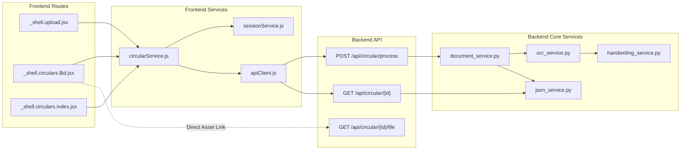

# CircularRoute — Component Reference & Testing Guide

This document provides a comprehensive technical reference for the components, functions, schemas, configuration settings, test suites, and dependency interactions across the **CircularRoute** repository.

---

## 1. Component Responsibility Matrix

| Component / File | Layer | Main Responsibility | Inputs | Outputs | Dependencies |
|---|---|---|---|---|---|
| [main.py](file:///c:/Users/Asus/Documents/CircularRoute/backend/main.py) | Backend (Entry Point) | Initializes FastAPI app, CORS middleware, and mounts API router | Environment variables (`PORT`, `HOST`) | ASGI Application | `fastapi`, `uvicorn`, [circular_routes.py](file:///c:/Users/Asus/Documents/CircularRoute/backend/app/api/circular_routes.py) |
| [circular_routes.py](file:///c:/Users/Asus/Documents/CircularRoute/backend/app/api/circular_routes.py) | Backend (API Router) | Exposes REST endpoints (`/health`, `/circular/process`, `/circular/{id}`, `/file`) | `UploadFile`, URL document IDs | JSON responses, binary file streams | `fastapi`, [document_service.py](file:///c:/Users/Asus/Documents/CircularRoute/backend/app/services/document_service.py), [json_service.py](file:///c:/Users/Asus/Documents/CircularRoute/backend/app/services/json_service.py) |
| [ocr_schema.py](file:///c:/Users/Asus/Documents/CircularRoute/backend/app/schemas/ocr_schema.py) | Backend (Data Schema) | Strict Pydantic models for OCR extraction contracts | Python dictionaries / raw data | Validated Pydantic models | `pydantic` |
| [recipient_schema.py](file:///c:/Users/Asus/Documents/CircularRoute/backend/app/schemas/recipient_schema.py) | Backend (Data Schema) | Schemas for directory entries and resolved recipients | Directory dictionaries | `DirectoryEntry`, `ResolvedRecipient` | `pydantic` |
| [distribution_schema.py](file:///c:/Users/Asus/Documents/CircularRoute/backend/app/schemas/distribution_schema.py) | Backend (Data Schema) | Schemas for email delivery payloads and timeline events | Dispatch requests | `DistributionRow`, `TimelineEvent` | `pydantic` |
| [document_service.py](file:///c:/Users/Asus/Documents/CircularRoute/backend/app/services/document_service.py) | Backend (Service) | Document ingestion orchestrator; coordinates page rendering, OCR, and storage | Raw file bytes, filename | `(OCRResult, output_path)` | [pdf_utils.py](file:///c:/Users/Asus/Documents/CircularRoute/backend/app/utils/pdf_utils.py), [image_utils.py](file:///c:/Users/Asus/Documents/CircularRoute/backend/app/utils/image_utils.py), [ocr_service.py](file:///c:/Users/Asus/Documents/CircularRoute/backend/app/services/ocr_service.py), [json_service.py](file:///c:/Users/Asus/Documents/CircularRoute/backend/app/services/json_service.py) |
| [ocr_service.py](file:///c:/Users/Asus/Documents/CircularRoute/backend/app/services/ocr_service.py) | Backend (Service) | Core OCR engine; PaddleOCR integration, Copy-To detection, noise filtering, crop extraction | Preprocessed page images, text lines | `(copy_to_found, pages, recipients, hw)` | `paddleocr`, [handwriting_service.py](file:///c:/Users/Asus/Documents/CircularRoute/backend/app/services/handwriting_service.py), [image_utils.py](file:///c:/Users/Asus/Documents/CircularRoute/backend/app/utils/image_utils.py) |
| [handwriting_service.py](file:///c:/Users/Asus/Documents/CircularRoute/backend/app/services/handwriting_service.py) | Backend (Service) | Microsoft TrOCR model manager; generates text predictions for handwritten image crops | Cropped PIL image | `(predicted_text, confidence)` | `transformers`, `torch`, `PIL` |
| [json_service.py](file:///c:/Users/Asus/Documents/CircularRoute/backend/app/services/json_service.py) | Backend (Service) | Physical JSON output storage in `outputs/<doc_id>.json` | `OCRResult` model instance | Target Path object, loaded dict | `json`, `pathlib` |
| [image_utils.py](file:///c:/Users/Asus/Documents/CircularRoute/backend/app/utils/image_utils.py) | Backend (Utility) | PIL/OpenCV image loading, CLAHE contrast enhancement, and bounding box cropping | Bytes, PIL Image, bounding boxes | OpenCV BGR array, cropped PIL Image | `PIL`, `cv2`, `numpy` |
| [pdf_utils.py](file:///c:/Users/Asus/Documents/CircularRoute/backend/app/utils/pdf_utils.py) | Backend (Utility) | PyMuPDF page rasterization at 200 DPI and native vector text block extraction | PDF file bytes | List of `(page_num, PIL.Image)`, block dicts | `pymupdf` (`fitz`), `PIL` |
| [recipient_service.py](file:///c:/Users/Asus/Documents/CircularRoute/backend/app/services/recipient_service.py) | Backend (Service) | Decoupled fuzzy matching service against Excel directory | Recipient objects or raw strings | `List[ResolvedRecipient]` | `openpyxl`, `difflib` |
| [distribution_service.py](file:///c:/Users/Asus/Documents/CircularRoute/backend/app/services/distribution_service.py) | Backend (Service) | Decoupled delivery log manager; maintains `distribution.json` | Dispatch results | `DistributionResponse` | `json`, `datetime` |
| [email_service.py](file:///c:/Users/Asus/Documents/CircularRoute/backend/app/services/email_service.py) | Backend (Service) | Decoupled SMTP email dispatcher with live/simulated mode | Recipient emails, message body | Status list | `smtplib`, `email.mime`, `asyncio` |
| [apiClient.js](file:///c:/Users/Asus/Documents/CircularRoute/frontend/src/services/apiClient.js) | Frontend (Service) | Low-level fetch wrapper with error response parsing | API path, HTTP options | Parsed JSON | Browser `fetch` |
| [circularService.js](file:///c:/Users/Asus/Documents/CircularRoute/frontend/src/services/circularService.js) | Frontend (Service) | Circular operations API client (upload, fetch, list, dashboard metrics) | Files, document IDs | Formatted circular data | [apiClient.js](file:///c:/Users/Asus/Documents/CircularRoute/frontend/src/services/apiClient.js), [sessionService.js](file:///c:/Users/Asus/Documents/CircularRoute/frontend/src/services/sessionService.js) |
| [sessionService.js](file:///c:/Users/Asus/Documents/CircularRoute/frontend/src/services/sessionService.js) | Frontend (Service) | Manages tab-level persistence in browser `sessionStorage` | Document IDs, circular data objects | Stored JSON data | Browser `sessionStorage` |
| [AppShell.jsx](file:///c:/Users/Asus/Documents/CircularRoute/frontend/src/layouts/AppShell.jsx) | Frontend (Layout) | Institutional layout shell with sidebar, command shortcut, and notifications | Child routes | Rendered application layout | `@tanstack/react-router`, `lucide-react` |
| [_shell.upload.jsx](file:///c:/Users/Asus/Documents/CircularRoute/frontend/src/routes/_shell.upload.jsx) | Frontend (Route) | Upload circular view with live 3-stage progress indicators | User file selection | Navigation to `/circulars/:id` | [circularService.js](file:///c:/Users/Asus/Documents/CircularRoute/frontend/src/services/circularService.js), [UploadDropzone.jsx](file:///c:/Users/Asus/Documents/CircularRoute/frontend/src/components/UploadDropzone.jsx) |
| [_shell.circulars.$id.jsx](file:///c:/Users/Asus/Documents/CircularRoute/frontend/src/routes/_shell.circulars.$id.jsx) | Frontend (Route) | Detailed circular view with original file preview, confidence, and recipients | Document ID param | Rendered inspection panels | [circularService.js](file:///c:/Users/Asus/Documents/CircularRoute/frontend/src/services/circularService.js), [DocumentPreview.jsx](file:///c:/Users/Asus/Documents/CircularRoute/frontend/src/components/DocumentPreview.jsx), [RecipientResolution.jsx](file:///c:/Users/Asus/Documents/CircularRoute/frontend/src/components/RecipientResolution.jsx) |
| [DocumentPreview.jsx](file:///c:/Users/Asus/Documents/CircularRoute/frontend/src/components/DocumentPreview.jsx) | Frontend (Component) | Renders original circular metadata banner and external viewer link | `circular` object | Metadata banner / viewer button | `lucide-react` |
| [RecipientResolution.jsx](file:///c:/Users/Asus/Documents/CircularRoute/frontend/src/components/RecipientResolution.jsx) | Frontend (Component) | Renders extracted recipient cards with printed vs handwritten badges | `circular` object | Recipient card list | [ConfidenceScore.jsx](file:///c:/Users/Asus/Documents/CircularRoute/frontend/src/components/ConfidenceScore.jsx), `motion` |
| [ExtractionPanel.jsx](file:///c:/Users/Asus/Documents/CircularRoute/frontend/src/components/ExtractionPanel.jsx) | Frontend (Component) | Confidence ring, field confidence bars, and editable metadata fields | `circular` object | Confidence and field cards | [ConfidenceScore.jsx](file:///c:/Users/Asus/Documents/CircularRoute/frontend/src/components/ConfidenceScore.jsx) |
| [DecisionFlow.jsx](file:///c:/Users/Asus/Documents/CircularRoute/frontend/src/components/DecisionFlow.jsx) | Frontend (Component) | Animated node diagram comparing confidence against threshold (90%) | `confidence` score | Visual decision flow | `motion`, `lucide-react` |
| [CircularTable.jsx](file:///c:/Users/Asus/Documents/CircularRoute/frontend/src/components/CircularTable.jsx) | Frontend (Component) | Responsive desktop table and mobile card list for circulars | `circulars` array | Rendered table / list | `@tanstack/react-router`, [StatusBadge.jsx](file:///c:/Users/Asus/Documents/CircularRoute/frontend/src/components/StatusBadge.jsx) |

---

## 2. Important Functions, Classes, and Methods

### Backend Services & Utilities

#### `DocumentService.process_document(file_bytes: bytes, filename: str) -> Tuple[OCRResult, str]`
- **File:** [document_service.py](file:///c:/Users/Asus/Documents/CircularRoute/backend/app/services/document_service.py)
- **Description:** Validates input extension (`.pdf`, `.jpg`, `.jpeg`, `.png`, `.webp`), generates `CIR-YYYYMMDD-XXXXXX`, saves file to canonical `backend/uploads/`, renders pages via PyMuPDF or PIL, runs OCR, saves `backend/outputs/<document_id>.json`, and returns the `OCRResult` model.

#### `OCRService.process_page_image(page_img: Image.Image, page_num: int) -> List[Dict[str, Any]]`
- **File:** [ocr_service.py](file:///c:/Users/Asus/Documents/CircularRoute/backend/app/services/ocr_service.py)
- **Description:** Preprocesses page image with CLAHE and passes it to PaddleOCR. Unpacks both PaddleOCR 3.x dictionary structures (`rec_texts`, `rec_scores`, `rec_boxes`) and PaddleOCR 2.x nested tuples into normalized line dictionaries.

#### `OCRService.parse_document_text_blocks(...) -> Tuple[bool, List[int], List[Recipient], List[HandwrittenText]]`
- **File:** [ocr_service.py](file:///c:/Users/Asus/Documents/CircularRoute/backend/app/services/ocr_service.py)
- **Description:** Identifies `COPY_TO_HEADER_PATTERN`, extracts column lines beneath the header, excludes boilerplate/signatures, detects standalone handwritten `to` markers, clips bounding crops, saves diagnostic crops, and triggers TrOCR inference.

#### `OCRService._create_recipient(raw: str, line_item: dict, page_num: int) -> Optional[Recipient]`
- **File:** [ocr_service.py](file:///c:/Users/Asus/Documents/CircularRoute/backend/app/services/ocr_service.py)
- **Description:** Strips bullet prefixes (`1.`, `2)`, `-`) and whitespace while preserving original names and abbreviations. Returns `None` for noise patterns or boilerplate.

#### `HandwritingService.predict_handwriting(image: Image.Image) -> Tuple[Optional[str], Optional[float]]`
- **File:** [handwriting_service.py](file:///c:/Users/Asus/Documents/CircularRoute/backend/app/services/handwriting_service.py)
- **Description:** Lazy-loads `microsoft/trocr-base-handwritten` from local Hugging Face cache. Converts image crop to RGB, runs PyTorch model inference, and decodes generated token IDs into clean text.

#### `save_output_json(ocr_result: OCRResult) -> Path` / `load_output_json(doc_id: str) -> Optional[dict]`
- **File:** [json_service.py](file:///c:/Users/Asus/Documents/CircularRoute/backend/app/services/json_service.py)
- **Description:** Handles physical file reading and writing in `outputs/<doc_id>.json`.

#### `extract_pdf_pages_as_images(pdf_bytes: bytes, dpi: int = 200) -> List[Tuple[int, Image.Image]]`
- **File:** [pdf_utils.py](file:///c:/Users/Asus/Documents/CircularRoute/backend/app/utils/pdf_utils.py)
- **Description:** Uses PyMuPDF (`fitz`) to render PDF pages at 200 DPI into PIL RGB images.

#### `preprocess_image_for_ocr(pil_img: Image.Image) -> np.ndarray`
- **File:** [image_utils.py](file:///c:/Users/Asus/Documents/CircularRoute/backend/app/utils/image_utils.py)
- **Description:** Converts PIL Image to OpenCV BGR and applies CLAHE contrast enhancement on the L channel in LAB color space.

---

### Frontend Services & Components

#### `uploadCircular(file: File): Promise<ProcessResponse>`
- **File:** [circularService.js](file:///c:/Users/Asus/Documents/CircularRoute/frontend/src/services/circularService.js)
- **Description:** Posts `FormData` to `/api/circular/process`, caches the document ID into recent IDs (`localStorage`) and session storage (`sessionStorage`), and returns the response.

#### `getCircular(id: string): Promise<CircularData>`
- **File:** [circularService.js](file:///c:/Users/Asus/Documents/CircularRoute/frontend/src/services/circularService.js)
- **Description:** Checks `sessionStorage` first for instant retrieval; if missing, fetches `GET /api/circular/{id}` from backend, formats data via `formatCircularData`, and populates `sessionStorage`.

#### `saveCircularToSession(documentId: string, circularData: object): void`
- **File:** [sessionService.js](file:///c:/Users/Asus/Documents/CircularRoute/frontend/src/services/sessionService.js)
- **Description:** Serializes circular object under key `circularroute_session_<documentId>` and updates `circularroute_session_index`.

#### `formatCircularData(data: object): FormattedCircular`
- **File:** [circularService.js](file:///c:/Users/Asus/Documents/CircularRoute/frontend/src/services/circularService.js)
- **Description:** Normalizes raw backend JSON into frontend schema, calculating overall confidence, field confidence breakdown, and document preview URL (`/api/circular/{id}/file`).

---

## 3. Configuration and Environment Reference

### Backend Configuration (`backend/.env.example`)

| Variable Name | Required | Default Value | Purpose |
|---|---|---|---|
| `APP_NAME` | No | `CircularRoute Backend` | Name displayed in FastAPI OpenAPI documentation |
| `HOST` | No | `127.0.0.1` | Network host interface for Uvicorn server |
| `PORT` | No | `8000` | Network port for Uvicorn server |
| `FRONTEND_URL` | No | `http://localhost:5173` | Allowed frontend origin for CORS middleware |
| `UPLOAD_DIR` | No | `backend/uploads` | Directory for raw uploaded files (anchored to `backend/uploads/`) |
| `OUTPUT_DIR` | No | `backend/outputs` | Directory for structured JSON outputs (anchored to `backend/outputs/`) |
| `DATA_DIR` | No | `data` | Directory for institutional directory databases |
| `SMTP_HOST` | No | *(empty)* | Optional SMTP server hostname for live email dispatching |
| `SMTP_PORT` | No | `587` | SMTP port (e.g., 587 for STARTTLS) |
| `SMTP_USER` | No | *(empty)* | SMTP authentication username |
| `SMTP_PASSWORD` | No | *(empty)* | SMTP authentication password (never commit actual values) |
| `SMTP_FROM_EMAIL` | No | `circulars@univ.edu` | Sender email address for circular notifications |
| `SMTP_FROM_NAME` | No | `CircularRoute Notification System` | Sender display name |
| `SMTP_USE_TLS` | No | `true` | Enables STARTTLS encryption |

### Frontend Build & Tooling Configuration

- **`frontend/package.json`**: Declares dependencies (`react: ^19.2.0`, `@tanstack/react-start: 1.168.60`, `tailwindcss: ^4.2.1`). Script commands: `dev`, `build`, `preview`, `lint`, `format`, `test`.
- **`frontend/bunfig.toml`**: Implements a 24-hour minimum package release age guard (`minimumReleaseAge = 86400`) to mitigate npm supply chain vulnerabilities.
- **`frontend/vite.config.ts`**: Configures TanStack Start with custom SSR error handling via `server: { entry: "server" }` pointing to `src/server.ts`.
- **`frontend/vitest.config.ts`**: Configures Vitest with jsdom environment, `@` path alias, and setup file `src/test/setup.ts`.
- **`frontend/components.json`**: Defines shadcn/ui configuration with New York style and Slate base colors.

---

## 4. Testing and Execution Guide

### Verified Backend Testing

Both backend test runners have been executed and verified in the local environment:

#### 1. Unittest OCR Runner (`run_tests.py`)
- **Execution Command:**
  ```powershell
  .\backend\venv\Scripts\python.exe backend/tests/run_tests.py
  ```
- **Verified Result:** **Ran 10 tests in 0.075s — OK (All 10 passed)**
- **Coverage:**
  1. `test_01_pdf_input_handling`: Verifies document service initializes PDF parser.
  2. `test_02_image_input_handling`: Verifies image ingestion and structured output generation.
  3. `test_03_multipage_handling`: Verifies tracking of Copy-To pages across multi-page circulars.
  4. `test_04_printed_recipients_preservation`: Verifies exact preservation of printed recipients.
  5. `test_05_handwritten_recipients_extraction`: Verifies handwritten annotation extraction.
  6. `test_06_abbreviations_preservation`: Verifies abbreviations (`HOD - CSE`, `PO - CSE`) are not expanded.
  7. `test_07_names_preservation`: Verifies exact preservation of full and partial names.
  8. `test_08_no_copy_to_section`: Verifies handling when no Copy-To section exists.
  9. `test_09_signature_exclusion`: Verifies signatures (`Registrar`, `Sd/-`) are excluded.
  10. `test_10_unsupported_file_type`: Verifies rejection of invalid extensions.

#### 2. Pytest Integration Test Suite (`pytest backend/tests/`)
- **Execution Command:**
  ```powershell
  .\backend\venv\Scripts\pytest.exe backend/tests/
  ```
- **Verified Result:** **24 passed in 76.93s (100% pass rate)**
- **Test Modules Verified:**
  - `backend/tests/test_api_endpoints.py`: 4 tests passed (`/api/health`, `/api/circular/process`, error handling).
  - `backend/tests/test_ocr_copy_to.py`: 16 tests passed (OCR edge cases, column alignment, noise rejection).
  - `backend/tests/test_recipient_email_distribution.py`: 4 tests passed (contract integrity, retired endpoint 404 verification).

---

### Verified Frontend Testing

The frontend test suite was executed using Vitest:

- **Execution Command:**
  ```bash
  cd frontend
  npm test
  ```
- **Verified Result:** **3 test files passed, 10 tests passed (100% pass rate)**
- **Test Modules Verified:**
  - `session-persistence.test.ts`: 5 tests passed (navigation persistence, multi-circular isolation, corrupted data recovery).
  - `document-preview-link.test.tsx`: 3 tests passed (preview button rendering, external URL integrity, fallback states).
  - `app-routing.test.tsx`: 2 tests passed (route matching for `/`, confirmation that `/directory` is not matched).

---

### Installation & Execution Commands

#### 1. Backend Setup & Run
```bash
# Navigate to backend
cd CircularRoute/backend

# Activate virtual environment
.\venv\Scripts\Activate.ps1   # Windows PowerShell
source venv/bin/activate       # Linux / macOS

# Install dependencies
pip install -r requirements.txt

# Start backend server
uvicorn main:app --reload --port 8000
```
- API Base URL: `http://127.0.0.1:8000`
- Interactive OpenAPI Docs: `http://127.0.0.1:8000/docs`

#### 2. Frontend Setup & Run
```bash
# Navigate to frontend
cd CircularRoute/frontend

# Install dependencies
npm install
# or: bun install

# Start development server
npm run dev
# or: bun dev
```
- Web Application URL: `http://localhost:5173`

#### 3. Building Frontend for Production
```bash
cd CircularRoute/frontend
npm run build
```

---

## 5. Dependency & Interaction Map



### Architectural Observations & Potential Issues Identified

1. **OCR Processing Latency on Full Inference:** Running PaddleOCR + PyTorch TrOCR sequentially on large multi-page documents can take 5–15 seconds per document on CPU. The frontend handles this gracefully by displaying a step-by-step progress pipeline with visual feedback.
2. **Offline TrOCR Dependency:** If `microsoft/trocr-base-handwritten` weights are not pre-cached in Hugging Face's local cache directory, `HandwritingService` logs a warning and falls back to primary OCR lines.
3. **Dual Directory Storage:** The repository contains both `data/` and `backend/data/`. `backend/data/CircularRoute_Data.xlsx` contains the full faculty directory, whereas `data/directory.json` is a minimal placeholder.
4. **Decoupled Delivery Endpoints:** The backend contains fully authored services for directory matching (`recipient_service.py`) and SMTP dispatching (`email_service.py`), but their API routes have been retired to keep the core OCR system focused.
